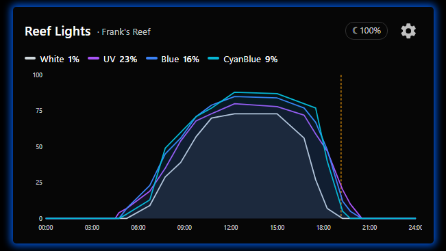
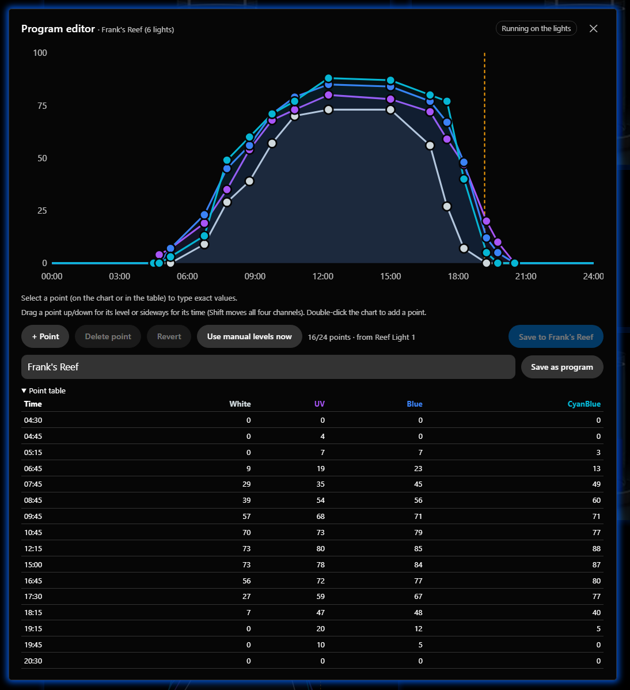

# Popbloom RL90 Reef Lights

Replacement firmware (ESPHome) and a Home Assistant dashboard card for Popbloom RL90 (DSuny) reef lights.
It cuts out the Tuya cloud. The goals are local control, more features and better stability, and so far it has been
stable.



## What you get

- **The program runs on the light itself.** Each light stores its daily program and runs it every second, with smooth
  fades instead of Tuya's 1% steps. It keeps running if Home Assistant or WiFi is down.
- **Program editor:** drag points on the chart or type exact values, then save to the lights or as a named program.
- **Programs:** the 16 stock Tuya scenes are built in, alongside your own saved programs. Apply one with a click.
- **Manual control:** sliders for each channel, for PAR testing or a quick scene. It goes back to the program by itself
  after a timeout.
- **Lunar cycle:** moonlight on White, Blue and Cyan, following the real moon at your location or a 29.5-day cycle
  of its own. It can follow moonrise to moonset, a time window or a duration.
- **Acclimation:** runs the whole program at a lower intensity, starting at 1–100%. It rises every midnight over 2–99
  days, then turns itself off.
- **Groups:** one group per tank. Lights in a group are kept in sync, with a one-click **Sync now**.

| Settings | Program editor |
|---|---|
|  |  |
| **Programs** | **Groups** |
|  |  |

## Is my light compatible?

This is for lights where a Tuya **CBU** (BK7231N) module drives the LEDs directly with PWM, with no separate
microcontroller. The pins are **P8 White, P7 UV, P6 Blue, P26 Cyan**. The Popbloom RL90 is built this way. Other lights
with a CBU module may work, but if their pins differ, you'll need to change them in `esphome/reeflight.yaml`.

## Getting started

Follow **[docs/flashing.md](docs/flashing.md)**. It's a complete first-time guide: the parts and software you need,
your settings, building the firmware, opening and flashing the light, adding it to Home Assistant, installing the card,
and updating lights over WiFi later. You only open each light once. After that, updates go over WiFi.

## What's in this repository

| Path | What |
|---|---|
| [`docs/flashing.md`](docs/flashing.md) | Step-by-step guide: settings, build, first flash over serial, Home Assistant, the card, OTA updates |
| [`esphome/reeflight.yaml`](esphome/reeflight.yaml) | The ESPHome (LibreTiny) firmware. One file for every light: the name is set when you build. |
| [`esphome/moon.h`](esphome/moon.h) | Moon phase, moonrise and moonset maths for the lunar cycle |
| [`esphome/secrets.example.yaml`](esphome/secrets.example.yaml) | Template for your private settings (copy it to `secrets.yaml`) |
| [`card/reef-light-card.js`](card/reef-light-card.js) | The Home Assistant card. No dependencies, so you only copy one file. |
| [`card/preview.html`](card/preview.html) | Test page that runs the card with fake lights, without Home Assistant |
| [`docs/dev-notes.md`](docs/dev-notes.md) | How the firmware and card work, for anyone changing them |
| [`docs/tuya-datapoints.md`](docs/tuya-datapoints.md) | The stock firmware's Tuya datapoints, for reference |

## Card configuration

The minimum:
```yaml
type: custom:reef-light-card
title: Reef Lights
programs: todo.reef_programs
```
Every light running this firmware is found automatically.

| Option | What |
|---|---|
| `title` | Card heading |
| `programs` | The Local To-do list that stores saved programs and groups (see the guide, part G) |
| `group` | Optional: show only this group, e.g. `group: Display`. Use one card per tank. |
| `max_points` | Most points a program can have (default 24) |
| `devices` | Optional: only needed to override a light's name or node (see below) |

The card itself is read-only. The **gear** opens Settings. A dropdown at the top of Settings picks a group or a single
light, and everything below applies to it.

<details>
<summary>Overriding a light</summary>

```yaml
devices:
  - name: Reef Light 1
    node: reeflight_1            # calls esphome.reeflight_1_set_curve
    curve: sensor.reef_light_1_curve
    power: switch.reef_light_1_power
    channels: [sensor.reef_light_1_white, sensor.reef_light_1_uv,
               sensor.reef_light_1_blue, sensor.reef_light_1_cyanblue]
```
</details>

A standalone sliders card is also included, e.g. for a pop-up:
```yaml
type: custom:reef-light-sliders-card
devices:
  - name: Reef Light 1
    curve: sensor.reef_light_1_curve      # the other entity IDs are worked out from this
resume_on_close: true                    # go back to the program when the card closes
```

## Entities per light

Shown for a light named `reef_light_1`.

| Entity | What |
|---|---|
| `switch.reef_light_1_power` | Master on/off |
| `sensor.reef_light_1_{white,uv,blue,cyanblue}` | Current output % per channel |
| `sensor.reef_light_1_curve` | The stored program (hex, same format as Tuya DP 107). Write it with `esphome.reeflight_1_set_curve`. |
| `number.reef_light_1_{white,uv,blue,cyanblue}_level` | Manual sliders. Moving one turns on manual override. |
| `switch.reef_light_1_manual_override` | Turn off to go back to the program. Also ends by itself after `number.reef_light_1_manual_timeout` minutes (default 5, 0 = never). |
| `switch.reef_light_1_lunar_cycle` | Moonlight on/off |
| `select.reef_light_1_lunar_sync` | **Day 1 start** (its own cycle from when it's turned on) or **Location** (the real moon) |
| `select.reef_light_1_lunar_hours` | **Moon up**, **Time window** or **Duration**, with `time.…_lunar_start`, `time.…_lunar_end` and `number.…_lunar_duration` |
| `number.reef_light_1_lunar_{white,blue,cyanblue}_max` | Moonlight level at full moon. 100% here = 10% output. UV is never used for moonlight. |
| `sensor.reef_light_1_moon_illumination`, `lunar_day`, `moon_phase`, `moon_altitude`, `next_moonrise`, `next_moonset` | Moon information |
| `switch.reef_light_1_acclimation` | Acclimation on/off. Turns itself off after the last day. |
| `number.reef_light_1_acclimation_initial_intensity` | Day 1 intensity, 1–100% |
| `number.reef_light_1_acclimation_duration` | Number of days, 2–99 |
| `sensor.reef_light_1_acclimation_day`, `acclimation_level` | Today's acclimation day and level |

Services (actions): `esphome.<node>_set_curve(hex)`, `esphome.<node>_set_lunar_location(lat, lon, place)` and
`esphome.<node>_set_acclimation_day(day)`.

## License

See [License.md](License.md).

This project isn't affiliated with Popbloom, DSuny or Tuya.
