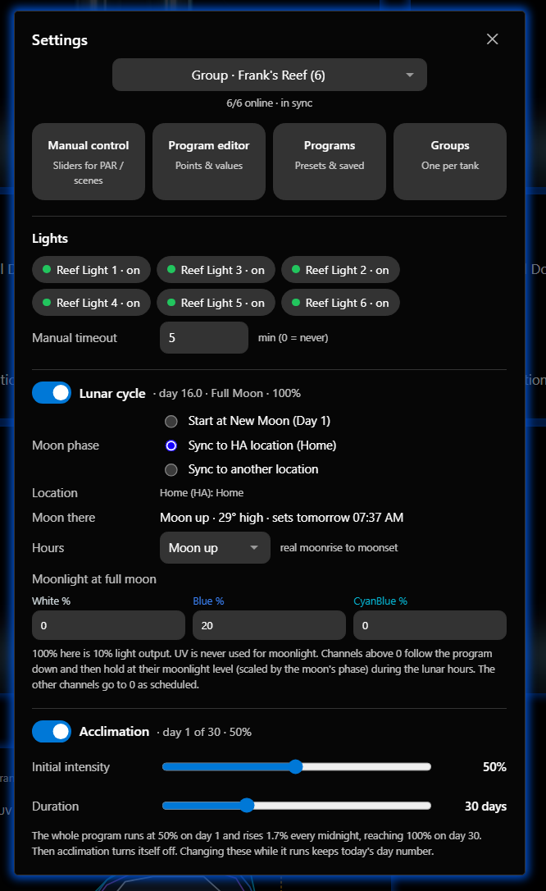
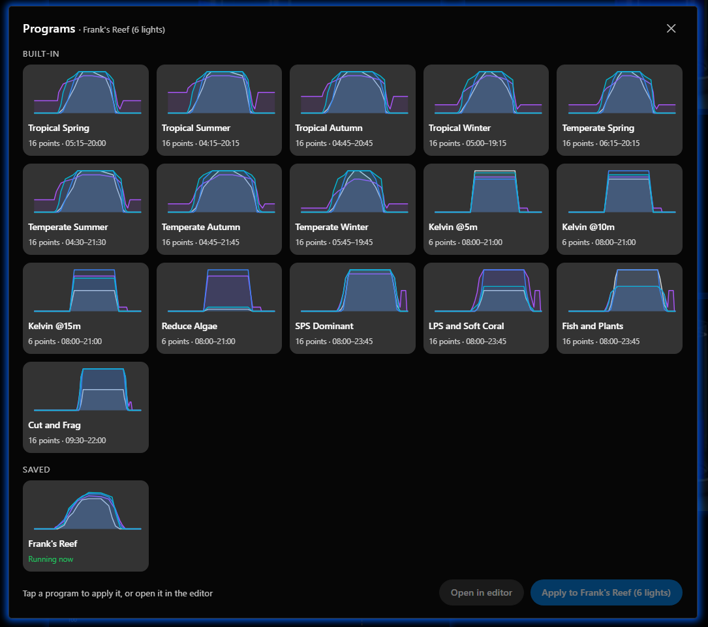
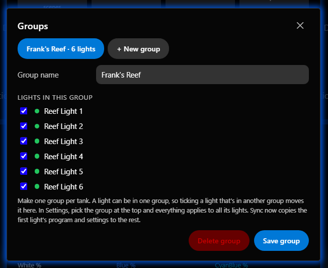

# Popbloom RL90 Reef Lights

Replacement firmware (ESPHome) and a Home Assistant dashboard card for Popbloom RL90 (DSuny) reef lights.
This effectively cuts them from Tuya cloud and can no longer be controlled by the Tuya App. 

The ultimate goals were for local control, added features and better stability. So far it has been
stable and zero issues.


## What you get

- **The program runs on the light itself.** Each light stores its daily program and runs it every second, with smooth
  fades instead of Tuya's 1% steps. It keeps running if Home Assistant or WiFi is down.
- **Program editor:** Drag points on the chart or type the exact values, then save the program to a name of your choosing.
- **Programs:** The original 16 stock Popbloom scenes were saved and added in, alongside with any you create and save. Easily apply one with one      click.
- **Manual control:** Sliders for each channel just like the original app. Can be useddfor PAR testing or for testing colors. It has a 5 minute       default timer that will revert back to the current program. This is to help prevent issues from accidentally forgetting and leaving them at a       level too bright
- **Lunar cycle:** Moonlight's can be setup to follow the real schedule at your location, any location in the world or start at day 1 of a 29.5-      day cycle. It can follow the real moonrise to moonset, a time window (i.e. from 10pm-2am) or a set duration (i.e. for 3 hours).
- **Acclimation:** runs the current program at a lower intensity. Select your starting intensity from 1–100% and how many days, 2-99, you want it     to run for. It increases the programs intensity at midnight. At the end of the scheduled duration, it will turn off and resume the normal program.
- **Groups:** Create as many groups as needed, whether you have multiple tanks, a light on your sump, or whatever. You can create multiple groups     and they can each be set to run their own programs. Lights added into a group are kept in sync, with a one-click of the **Sync now** button.

| Settings | Program editor |
|---|---|
|  |  |
| **Programs** | **Groups** |
|  |  |

## Is my light compatible?

This is for lights where a Tuya **CBU** (BK7231N) module drives the LEDs directly with PWM, with no separate
microcontroller. The pins are **P8 White, P7 UV, P6 Blue, P26 Cyan**. The Popbloom RL90 is built this way. Other lights
with a CBU module may work, but if their pins differ, you'll need to change them in `esphome/reeflight.yaml`.

### Required Hardware
| Item | Notes |
|---|---|
| **USB-to-serial adapter, 3.3 V** | E.g. SparkFun Serial Basic Breakout (CH340C, USB-C): https://www.sparkfun.com/sparkfun-serial-basic-breakout-ch340c-and-usb-c.html. It **must** be set to 3.3vdc. Utilizing 5vdc can destroy the module. |
| USB data cable for the serial adapter | Some cables only charge and carry no data. Use one you know carries data. |
| Soldering iron, 5x thin wire (about 26ga is recommended), flux  | You solder to the module's pins. In place of soldering, using SMD leads/clips might work. **[Clip example](https://a.co/d/00IDyCbX)** |
| Small Philips screwdrivers | To open the light housing. |
| A PC running Windows | I'm sure other OS's can be used, but I can't confirm |
| Home Assistant | Any recent version, with the ESPHome integration or whatever you will use to communicate with ESPHome |
| A **2.4 GHz** WiFi network | The BK7231N chip can't use 5 GHz. |

## Getting started

## CYA (mine)

**First and foremost I am not responsible for any damage or harm that may come by following this guide. The procedures were tested and completed by me on six lights and they are all working perfectly.*** 

**None of this is hard, but you need to solder wires onto some small pads and if you don't know how to properly then you could hurt yourself or damage the hardware.**

If you are still in then please completely read **ALL** the following and ensure you know what is required before you start. 

Follow **[docs/flashing.md](docs/flashing.md)**. It's a complete first-time guide: the parts and software you need,
your settings, building the firmware, opening and flashing the light, adding it to Home Assistant, installing the card,
and updating lights over WiFi later. You only open each light once. After that, updates go over WiFi.

## What's in this repository

| Path | What |
|---|---|
| [`docs/flashing.md`](docs/flashing.md) | Step-by-step guide: settings, build, first flash over serial, Home Assistant, the card, OTA updates |
| [`esphome/reeflight.yaml`](esphome/reeflight.yaml) | The ESPHome (LibreTiny) firmware template. You will need one file per light light: the name is set when you build. |
| [`esphome/moon.h`](esphome/moon.h) | Moon phase, moonrise and moonset maths for the lunar cycle |
| [`esphome/secrets.example.yaml`](esphome/secrets.example.yaml) | Template for your private settings (copy it to `secrets.yaml`) |
| [`card/reef-light-card.js`](card/reef-light-card.js) | The Home Assistant card. No dependencies, so you only copy one file. |
| [`card/preview.html`](card/preview.html) | Test page that runs the card with fake lights, without Home Assistant for any dev testing |
| [`docs/dev-notes.md`](docs/dev-notes.md) | How the firmware and card work, for anyone looking to tweak or build up them |
| [`docs/tuya-datapoints.md`](docs/tuya-datapoints.md) | The stock firmware's Tuya datapoints, for reference |

## Card configuration

The minimum:
```yaml
type: custom:reef-light-card
title: Reef Lights
programs: todo.reef_programs
```
Every light running this firmware is found automatically.

| Option | What |
|---|---|
| `title` | Card heading |
| `programs` | The Local To-do list that stores saved programs and groups (see the guide, part G) |
| `group` | Optional: show only this group, e.g. `group: Display`. Use one card per tank. |
| `max_points` | Most points a program can have (default 24) |
| `devices` | Optional: only needed to override a light's name or node (see below) |

The card itself is read-only. The **gear** opens a Settings card. Use the dropdown at the top of Settings card to pick a group or a single
light and any changes made will only affect the item selected.


Overriding a light

```yaml
devices:
  - name: Reef Light 1
    node: reeflight_1            # calls esphome.reeflight_1_set_curve
    curve: sensor.reef_light_1_curve
    power: switch.reef_light_1_power
    channels: [sensor.reef_light_1_white, sensor.reef_light_1_uv,
               sensor.reef_light_1_blue, sensor.reef_light_1_cyanblue]
```

A standalone sliders card is also included.
```yaml
type: custom:reef-light-sliders-card
devices:
  - name: Reef Light 1
    curve: sensor.reef_light_1_curve      # the other entity IDs are worked out from this
resume_on_close: true                    # go back to the program when the card closes
```

## Entities per light

Shown for a light named `reef_light_1`.

| Entity | What |
|---|---|
| `switch.reef_light_1_power` | Master on/off |
| `sensor.reef_light_1_{white,uv,blue,cyanblue}` | Current output % per channel |
| `sensor.reef_light_1_curve` | The stored program (hex, same format as Tuya DP 107). Write it with `esphome.reeflight_1_set_curve`. |
| `number.reef_light_1_{white,uv,blue,cyanblue}_level` | Manual sliders. Moving one turns on manual override. |
| `switch.reef_light_1_manual_override` | Turn off to go back to the program. Also ends by itself after `number.reef_light_1_manual_timeout` minutes (default 5, 0 = never). |
| `switch.reef_light_1_lunar_cycle` | Moonlight on/off |
| `select.reef_light_1_lunar_sync` | **Day 1 start** (begins a cycle starting at the beginning of a cycle starting the day it is turned on) or **Location** (the real moon) |
| `select.reef_light_1_lunar_hours` | **Moon up**, **Time window** or **Duration**, with `time.…_lunar_start`, `time.…_lunar_end` and `number.…_lunar_duration` |
| `number.reef_light_1_lunar_{white,blue,cyanblue}_max` | Moonlight level at full moon. A setting of 100% here will translate to only 10% of channel's max output. UV is not used for moonlight. |
| `sensor.reef_light_1_moon_illumination`, `lunar_day`, `moon_phase`, `moon_altitude`, `next_moonrise`, `next_moonset` | Moon information |
| `switch.reef_light_1_acclimation` | Acclimation on/off. Will turn itself off after the cycle is completed. |
| `number.reef_light_1_acclimation_initial_intensity` | Day 1 intensity, 1–100% |
| `number.reef_light_1_acclimation_duration` | Number of days, 2–99 |
| `sensor.reef_light_1_acclimation_day`, `acclimation_level` | Today's acclimation day and level |

Services (actions): `esphome.<node>_set_curve(hex)`, `esphome.<node>_set_lunar_location(lat, lon, place)` and
`esphome.<node>_set_acclimation_day(day)`.

## License

[Prosperity Public License 3.0.0](LICENSE.md): 100% free to use, change and share for noncommercial purposes. Commercial use is limited to a 30-day trial any use beyond the trial requires a paid license.

This project isn't affiliated with Popbloom, DSuny, Tuya or any other company. All code, with the exception of the 16 lighting programs, is 100% original and made by me. 
