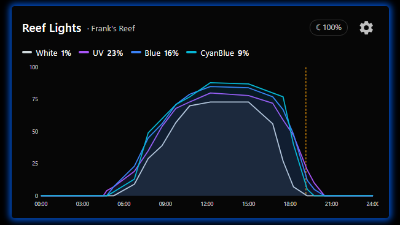
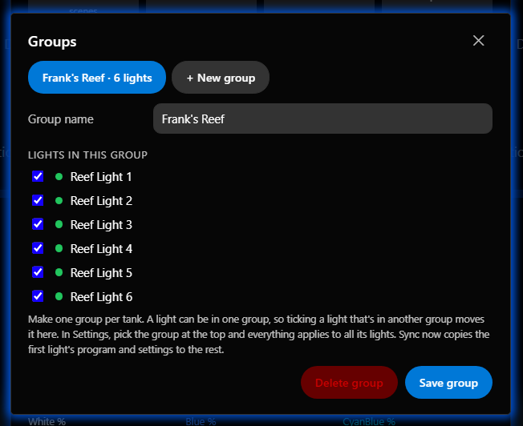
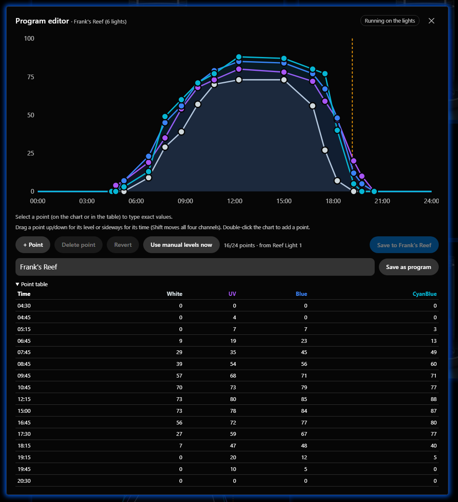
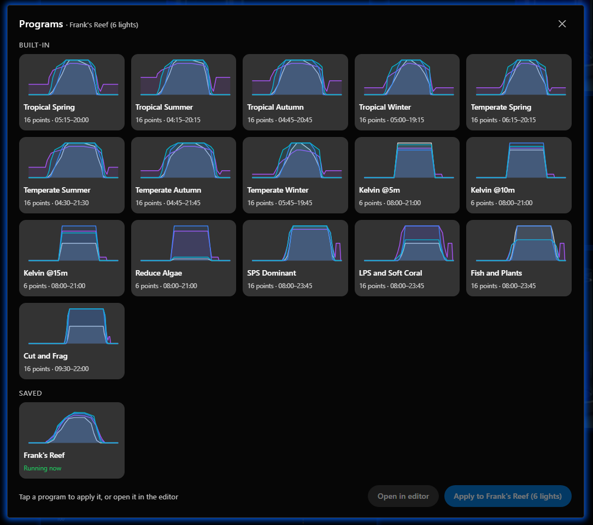

# Converting a Popbloom RL90 reef light to ESPHome: complete guide

This guide takes a stock Popbloom RL90 reef light (Popbloom/DSuny firmware, Tuya **CBU** module) and turns it into a light that
runs **locally** with Home Assistant (HA), with no Tuya cloud. It assumes you've never done this before.

**What you'll end up with:** each light stores its own daily program and runs it even if HA or WiFi is down. HA shows
the light, and the reef light card lets you edit programs, use manual control and moonlight, and group lights per tank.

**What it takes:** about 1 hour for the first light, then about 20 minutes per light. You need basic soldering.

> ⚠️ **Read before starting**
> - **Unplug the light from mains power** before opening it, and keep it unplugged while soldering and flashing.
>   The module is powered from the USB adapter instead.
> - This firmware is written for lights where the CBU module drives the LEDs directly on pins **P8 (White), P7 (UV),
>   P6 (Blue), P26 (Cyan)**. A different board layout may need different pins (see Troubleshooting).
> - Back up the original firmware (part E). It's your only way back to stock.

---

## Overview

| Part | What you do | Once or per light |
|---|---|---|
| A | Get the hardware and software | Once |
| B | Install the software on your PC | Once |
| C | Create your settings: WiFi, hotspot password, encryption key, timezone | Once |
| D | Build the firmware for each light | Per light |
| E | Open the light, wire it, back it up and flash it | Per light |
| F | Add the light to Home Assistant | Per light |
| G | Install the reef light card in Home Assistant | Once |
| H | Updating lights later, over WiFi | When the firmware changes |

The commands are for **Windows PowerShell**. On macOS or Linux they're the same, except use `venv/bin/esphome`
instead of `venv\Scripts\esphome`. OpenIOTFlasher is Windows only.

---

## A. What you need

### Hardware
| Item | Notes |
|---|---|
| **USB-to-serial adapter, 3.3 V** | E.g. SparkFun Serial Basic Breakout (CH340C, USB-C): https://www.sparkfun.com/sparkfun-serial-basic-breakout-ch340c-and-usb-c.html. It **must** be 3.3 V. 5 V can destroy the module. |
| USB cable for the adapter | Some cables only charge and carry no data. Use one you know carries data. |
| Soldering iron, thin wire (5 leads), flux | You solder to the module's pins. |
| Small screwdrivers / pry tool | To open the light housing. |
| A PC running Windows | For OpenIOTFlasher. |
| Home Assistant | Any recent version, with the ESPHome integration (built in). |
| A **2.4 GHz** WiFi network | The BK7231N chip can't use 5 GHz. |

### Software (all free)
| Software | Download | What it's for |
|---|---|---|
| CH340 USB driver | https://learn.sparkfun.com/tutorials/how-to-install-ch340-drivers/all (or WCH's installer: https://www.wch-ic.com/downloads/CH341SER_EXE.html) | Lets Windows talk to the adapter |
| OpenIOTFlasher | https://github.com/DeDaMrAzR/OpenIOTFlasher/releases/latest: get `OpenIOTFlasher-v<version>.zip` | Backs up the stock firmware and writes the new firmware over the serial wires. A fork of BK7231GUIFlashTool (https://github.com/openshwprojects/BK7231GUIFlashTool). |
| Python 3.12 or newer | https://www.python.org/downloads/windows/ | Runs ESPHome, which builds the firmware |
| Git (optional) | https://git-scm.com/download/win | To download this project with `git clone`. You can download a ZIP instead. |
| This project | https://github.com/Ftown14/Popbloom-RL90-Reef-Lights: the green **Code** button → **Download ZIP**, or `git clone` | The firmware recipe (`esphome/reeflight.yaml`) and the card |

Useful references:
- Tuya CBU module datasheet, with pin numbers: https://developer.tuya.com/en/docs/iot/cbu-module-datasheet?id=Ka07pykl5dk4u
- ESPHome encryption key (`api:` docs): https://esphome.io/components/api/

---

## B. Install the software (once)

1. **Install the CH340 driver.** Run the installer, then plug the adapter into the PC.
   - **Check:** open Device Manager → **Ports (COM & LPT)**. You'll see **USB-SERIAL CH340 (COM*n*)**. Write down the
     COM number.
2. **Install OpenIOTFlasher.** Unzip it to a folder, e.g. `C:\ReefFlash\OpenIOTFlasher`.
   - **Check:** double-click `OpenIOTFlasher.exe` and it opens. If Windows SmartScreen warns, click
     **More info → Run anyway**.
3. **Install Python.** Run the installer and, on its first screen, **tick "Add python.exe to PATH"**, then
   **Install Now**.
   - **Check:** open a new PowerShell window and run `python --version`. It prints `Python 3.12.x` or newer.
4. **Get this project** into a folder, e.g. `C:\ReefFlash\Popbloom-RL90-Reef-Lights`. Either download the ZIP and
   unzip it there (rename the unzipped folder to `Popbloom-RL90-Reef-Lights` if it ends in `-main`), or:
   ```powershell
   cd C:\ReefFlash
   git clone https://github.com/Ftown14/Popbloom-RL90-Reef-Lights.git
   ```
5. **Install ESPHome** inside the project folder:
   ```powershell
   cd C:\ReefFlash\Popbloom-RL90-Reef-Lights
   python -m venv venv
   venv\Scripts\pip install esphome
   ```
   - `venv` is a private Python folder for this project, so ESPHome doesn't touch anything else on your PC.
   - **Check:** `venv\Scripts\esphome version` prints `Version: 20xx.x.x`.

---

## C. Create your settings (once)

The firmware needs a few private values. They go in a file called **`secrets.yaml`** in the `esphome` folder, so they
never appear in the project's shared files. **Never share or upload `secrets.yaml`.** It's listed in `.gitignore`,
so Git won't upload it by accident.

### C1. Generate an encryption key (`api_key`)

The encryption key is a random password **you create yourself**. Nothing gives it to you. It:
- encrypts all traffic between Home Assistant and the light, so nobody else on your network can read or control it;
- is what HA asks for when you add the light ("Enter the encryption key");
- is baked into the firmware when you build it.

Use **one key for all your lights**. That way you only ever paste the same key into HA.

Generate one in PowerShell:
```powershell
python -c "import secrets, base64; print(base64.b64encode(secrets.token_bytes(32)).decode())"
```
It prints something like `k3J9…=` (44 characters, ending in `=`). Copy all of it, including the `=`.

> **Keep a copy somewhere safe** (e.g. a password manager). If you lose it, HA can't connect to the lights until you
> build and flash new firmware with a new key.

### C2. Choose a fallback hotspot password (`ap_password`)

If a light can't join your WiFi (wrong password, router changed, out of range), it doesn't go dead. After about a
minute it starts its **own WiFi hotspot**, called **"Reef Light N Setup"**, so you can fix it from a phone:
1. Join "Reef Light N Setup" using **this password**.
2. A setup page opens, or browse to http://192.168.4.1.
3. Pick your WiFi network, enter its password, and the light reboots onto it.

The `ap_password` is just the password for that rescue hotspot. Pick anything **8 characters or longer** that you'll
remember or can find. It isn't your WiFi password.

### C3. Your WiFi name and password

`wifi_ssid` is your WiFi network name, exactly as it appears (it's case-sensitive). `wifi_password` is its password.
It must be a **2.4 GHz** network.

### C4. Create `secrets.yaml`

In the project's `esphome` folder there's a template called **`secrets.example.yaml`**. Copy it to a file named
**`secrets.yaml`** in the same folder:
```powershell
cd C:\ReefFlash\Popbloom-RL90-Reef-Lights\esphome
copy secrets.example.yaml secrets.yaml
notepad secrets.yaml
```
If you make the file in File Explorer instead, make sure Windows doesn't save it as `secrets.yaml.txt`: turn on
View → Show → File name extensions. Replace the example values so the file looks like this:
```yaml
wifi_ssid: "YourWiFiName"
wifi_password: "YourWiFiPassword"
ap_password: "rescue-hotspot-password"
api_key: "the 44-character key from C1"
```
Keep the quotes. The `#` comments at the ends of the lines can stay or go.

### C5. Set your timezone

Each light runs its program on its own clock, so it needs your timezone. Open `esphome\reeflight.yaml` in a text
editor (Notepad is fine). Near the top, under `substitutions:`, change:
```yaml
  timezone: America/Chicago
```
to your zone's name from https://en.wikipedia.org/wiki/List_of_tz_database_time_zones (the **TZ identifier** column),
e.g. `Europe/London`, `America/New_York` or `Australia/Sydney`.

Leave everything else in the file as it is.

---

## D. Build the firmware (per light)

Each light gets its **own** firmware file containing its name. Number your lights 1, 2, 3, or however you like. Write the number on each light, and build one file per light.

| Light | Build with | Shows in HA as |
|---|---|---|
| 1 | `-s name reeflight-1 -s friendly_name "Reef Light 1"` | Reef Light 1 |
| 2 | `-s name reeflight-2 -s friendly_name "Reef Light 2"` | Reef Light 2 |
| … | … | … |

> **Never flash one light's file onto another light.** Two lights with the same name clash on your network and in HA.

1. Open PowerShell in the `esphome` folder:
   ```powershell
   cd C:\ReefFlash\Popbloom-RL90-Reef-Lights\esphome
   ```
2. Build light 1. To build another light, change both numbers:
   ```powershell
   ..\venv\Scripts\esphome -s name reeflight-1 -s friendly_name "Reef Light 1" compile reeflight.yaml
   ```
   - The first build downloads the build tools and takes 5–10 minutes. Later builds take 1–2 minutes.
   - **Check:** the output ends with `Successfully compiled program.`
   - An error mentioning `secrets.yaml` means the file is missing, misnamed, or a value is missing (part C4).
3. **Copy the result** into OpenIOTFlasher's `firmwares` folder, renamed so you can tell the lights apart:
   ```powershell
   copy .esphome\build\reeflight-1\.pioenvs\reeflight-1\firmware.uf2 C:\ReefFlash\OpenIOTFlasher\firmwares\reeflight-1.uf2
   ```
   (Create the `firmwares` folder first if it doesn't exist.)

The `.uf2` file contains your WiFi password and encryption key. Don't share it.

---

## E. Open, wire, back up and flash (per light)

### E1. Open the light and find the module

1. **Unplug the light from mains power.**
2. The top plastic cover pops off by hand, revealing the fan and 4 screws in the corners. Remove only those 4 screws.
   The lower housing and lens then come off.
3. Find the **CBU module**: a small board soldered onto the control board, usually with "CBU" printed on its metal
   shield. It has small pins along its edges, numbered as in the Tuya datasheet (link in part A).
   - There are a few revisions of the board. I bought mine in 2023 and received a couple of replacement chipsets, so
     there may be newer ones than the examples below. As long as the module says **CBU**, you're fine. If it says
     anything else, this firmware hasn't been tested on it.

### E2. Solder the wires

Count the pins **on the module itself**, using the datasheet. The photo shows which pads to use on the CBU module:


> ⚠️ The control board may have silkscreen labels like **`P15`/`P16`** nearby. Those are chip GPIO names, **not**
> module pins 15 and 16. Soldering to them won't work.

| CBU module pin | Signal | Connect to adapter |
|---|---|---|
| **15** | TX1 (module transmits) | **RX** (RXI on the SparkFun) |
| **16** | RX1 (module receives) | **TX** (TXO on the SparkFun) |
| **14** | 3V3 (power in) | **3V3** |
| **13** | GND | **GND** |
| **18** | CEN (reset) | Not connected. Leave this lead loose; you'll tap it to GND to reset the chip. |

- TX and RX **cross over**: the module's transmit goes to the adapter's receive, and the other way round.
- **Set the adapter to 3.3 V** before plugging it in. The SparkFun Serial Basic has a voltage switch.
- Keep the light unplugged from mains. The adapter powers the module.

### E3. Get the chip into download mode

To be read or written, the chip has to be reset into its **download mode** while the flasher is waiting for it.
**Once it's in download mode, it stays there for the backups and the flash**, as long as nothing gets unplugged. So
you only have to do this once per light.

1. Plug the adapter into the PC and open **OpenIOTFlasher**.
2. Select the adapter's **COM port** (from part B1).
3. Select the platform **BK7231N** ("BK7231N (T2, T34, BL2028N)").
4. Start a **backup (read only)**. The log shows **`Getting bus...`**: it's waiting for the chip.
5. **Now reset the chip:**
   - **Tap the CEN lead to GND briefly.** This is finicky. It can take a few tries to get the timing right.
   - **If CEN won't work:** pull the **3V3** lead off and put it back. OpenIOTFlasher will stop with an error saying
     the **COM port disconnected**. That's expected. **Start the backup again** and it begins instantly, because the
     chip is now in download mode.
6. Once it starts reading, leave everything alone until it finishes.

### E4. Back up the original firmware (twice)

The backup is a full copy of the stock (Popbloom/DSuny) firmware. It's the only way to return the light to stock.
Making two and checking they're identical proves the read was clean.

1. The first backup from E3 finishes and is saved in OpenIOTFlasher's **`backups`** folder.
2. **Start a second backup** without unplugging anything. It starts straight away.
3. **Compare them** in PowerShell:
   ```powershell
   cd C:\ReefFlash\OpenIOTFlasher\backups
   Get-FileHash * -Algorithm SHA256 | Sort-Object { (Get-Item $_.Path).LastWriteTime } | Select-Object -Last 2 Hash, Path
   ```
   - **The two Hash values must be identical.** If they're not, a wire is probably loose. Reflow the joints and back
     up again until two match.
4. **Rename the good backup** after the light (e.g. `light-1-stock.bin`) and keep it somewhere safe.
   It may contain your old Tuya WiFi details, so don't share it.

### E5. Flash the new firmware

1. Without unplugging anything, choose **this light's** file, e.g. `reeflight-1.uf2`, in OpenIOTFlasher.
   **Double-check the number.** If the file isn't listed, check it's in the `firmwares` folder (part D3) and restart
   OpenIOTFlasher.
2. **Write the firmware (write only).** The chip is still in download mode from E3, so it starts right away.
   If it waits at `Getting bus...` again, reset the chip as in E3 step 5.
3. Wait until the write and verify finish without errors.
4. Unplug the adapter from the PC, then **unsolder the leads** and close the light up.

---

## F. Add the light to Home Assistant (per light)

1. **Plug the light into mains power.** Within about 30 seconds it boots, joins your WiFi and starts its default
   daily program.
   - If it can't join your WiFi, use the rescue hotspot after about a minute (see C2).
2. In HA, go to **Settings → Devices & services**. Under **Discovered**, you'll see **ESPHome: reeflight-N**.
   Click **Add**.
   - Not shown? Click **+ Add integration → ESPHome** and type `reeflight-N.local`, or the light's IP from your
     router, with port `6053`.
3. When asked for the **encryption key**, paste your `api_key` from C1.
4. **Leave the area blank** and click **Finish**.
   - If you pick an area here, HA adds it to the front of every entity ID (e.g. `aquarium_reef_light_1_power`).
     That still works, but the names get long.
5. **Then set the area:** open the new device, click the **pencil**, choose the area (e.g. Aquarium) and save.
   The entity IDs stay as `reef_light_N_*`.
6. **Check it:** the device page lists entities such as **Power**, **White/UV/Blue/CyanBlue**, **Curve**, **Manual
   override**, **Lunar cycle** and **Acclimation**. Its firmware version is shown under Device info.

---

## G. Install the reef light card (once)

The card gives you the program chart, editor, manual sliders, moonlight settings and tank groups.

1. **Copy the card file into HA.** Put `card/reef-light-card.js` from this project into HA's **`/config/www/`**
   folder (create `www` if it doesn't exist). Two easy ways:
   - the **Samba share** add-on: https://www.home-assistant.io/common-tasks/os/#installing-and-using-the-samba-add-on
   - the **File editor** add-on: https://github.com/home-assistant/addons/blob/master/configurator/DOCS.md
   If you created the `www` folder just now, **restart Home Assistant** once.
2. **Register it as a resource.** Turn on **Advanced mode** in your HA user profile (click your name, bottom left).
   Then go to **Settings → Dashboards → ⋮ (top right) → Resources → + Add resource**:
   - URL: `/local/reef-light-card.js`
   - Resource type: **JavaScript module**
3. **Create the list that stores your saved programs and groups.** Go to **Settings → Devices & services →
   + Add integration → Local To-do**, and name it **`Reef programs`**. This creates `todo.reef_programs`.
   (Docs: https://www.home-assistant.io/integrations/local_todo/)
4. **Add the card to a dashboard.** Edit the dashboard → **+ Add card → Manual**, and paste:
   ```yaml
   type: custom:reef-light-card
   title: Reef Lights
   programs: todo.reef_programs
   ```
   The card finds every light running this firmware automatically. It shows the running program, its name and each
   channel's live level:

   
5. **Hard-refresh the browser** (Ctrl+F5) if the card says "Custom element doesn't exist".
6. **Group lights on the same tank.** On the card, click the **gear → Groups → + New group**, name it, tick its
   lights and click **Save group**. Then click **Sync now** to copy the first light's program and settings to the others.
   Adding a light later works the same way: tick it, save, then Sync now.

   

### Using the card

The card itself only displays. Click the **gear** to open Settings. The dropdown at the top picks a group or a single
light, and everything below applies to it.

- **Settings:** light power, manual timeout, **Lunar cycle** and **Acclimation**. Each one's options appear when its
  switch is on.

  

  - **Lunar cycle:** moonlight on White, Blue and Cyan. The max levels are at full moon, where 100% is 10% of the
    light's output. UV isn't used for moonlight.
  - **Acclimation:** for new corals or a new light. The whole program runs at the **Initial Intensity** on the day you
    turn it on, rises a little at every midnight, and reaches 100% after the **Duration** in days. Then the switch turns
    itself off.
- **Program editor:** drag points on the chart or type exact times and levels. **Save to lights** sends it to the
  lights; **Save as program** keeps it in your list under a name.

  

- **Programs:** the 16 built-in Tuya scenes and your saved programs. Pick one to apply it or open it in the editor.

  

- **Manual control:** a slider per channel, e.g. for PAR testing. Closing it, or the manual timeout, goes back to the
  program.

---

## H. Updating lights later, over WiFi

Once a light runs this firmware you never need to open it again. After changing the firmware, or to pick up a newer
version of this project, update each light over WiFi from the `esphome` folder:
```powershell
..\venv\Scripts\esphome -s name reeflight-1 -s friendly_name "Reef Light 1" run reeflight.yaml --device reeflight-1.local
```
- **The name must be the light's own name.** Using `reeflight-2` on light 1 would rename light 1.
- If `reeflight-1.local` isn't found, use the light's IP address (shown on its HA device page).
- The light restarts and is dark for a few seconds, then carries on. **Its program and settings are kept.**
- Do one light at a time, and check it's back in HA before the next.

**Updating the card:** copy the new `card/reef-light-card.js` over the old one in `/config/www/`, then hard-refresh
the browser (Ctrl+F5). If the old version still shows, edit the resource URL to `/local/reef-light-card.js?v=2`
(any new number), which forces browsers to fetch it again.

**Without the command line:** every light has a web page at `http://<light's IP>`. Build the light's `.uf2` (part D),
then on that page under **OTA Update**, choose the file and upload it.

> **Security note:** anyone on your home network can open a light's web page, including its upload box. If that
> concerns you, add a password under `web_server:` in `reeflight.yaml` (`auth: username/password`,
> see https://esphome.io/components/web_server/).

---

## Troubleshooting

| Problem | Cause and fix |
|---|---|
| No COM port appears | Driver not installed (B1) or a charge-only cable. Try another cable or USB port. |
| Stuck at `Getting bus...` | The chip didn't reset into download mode. Tap CEN to GND again; if that fails, pull and replace 3V3 and start the backup again (E3). |
| "COM port disconnected" | Expected after pulling 3V3. Start the backup again. |
| Backups don't match | Loose or dry solder joint. Reflow the joints; try a lower baud rate in OpenIOTFlasher. |
| Compile error about `secrets.yaml` | File missing, saved as `secrets.yaml.txt`, or a value missing (C4). |
| Light doesn't appear in HA | It's not on your WiFi. Check it's a 2.4 GHz network and the details in `secrets.yaml`; or join the rescue hotspot (C2). |
| HA rejects the encryption key | The key must match the one the firmware was built with, exactly, including the `=`. |
| Light comes on at full brightness and ignores its program | The pins on your board differ from this firmware's. Unused or wrong pins float to full on. Check your board's pins before going further. |
| Two lights share a name | One got the other's file. Rebuild with the right name and update it over WiFi (part H). |
| Wrong time or program runs at the wrong hours | Timezone not set (C5). Fix it, rebuild, and update each light (part H). |
| Card shows "Custom element doesn't exist" | The resource isn't added, or the browser cached the old page. Check G2, then Ctrl+F5. |
| After renaming a light, commands go to the wrong light | HA keeps the old name's mapping. **Settings → Devices & services → ESPHome →** the light → **⋮ → Reload**. |
